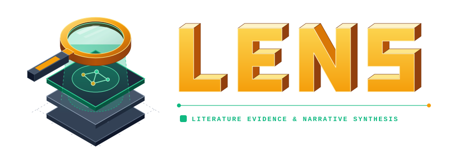
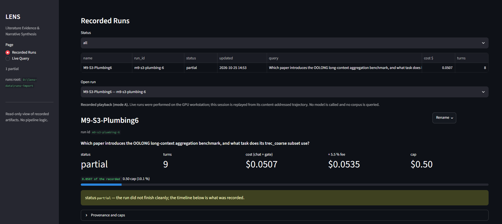
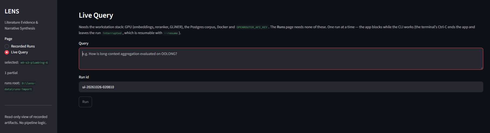

LENS answers systematic literature review questions over a GROBID-structured
arXiv cs.AI corpus. A run segments the question, retrieves evidence in two
stages, optionally builds a knowledge graph over the retrieved chunks, and lets a
root model write and execute Python against that evidence inside a Docker
sandbox. Every claim in the answer cites a `chunk_uuid` that resolves back to the
retrieved text.

## Requirements

- Python 3.12 and [uv](https://docs.astral.sh/uv/)
- Docker Desktop, for the corpus database and the sandbox
- An OpenRouter API key
- An arXiv cs.AI corpus: a metadata dump plus one GROBID TEI file per paper
- A CUDA GPU for the embedding, reranking and NER models. The viewer does not
  need one.

## Setup

```powershell
git clone https://github.com/RSGzen/LENS.git
cd LENS
uv sync
```

Copy `.env.example` to `.env`. The three secrets are the values you must supply;
the rest of the file already matches `docker compose` and works unchanged.
`LENS_DATA_ROOT` is the one setting worth reviewing: it defaults to the platform
data directory, and setting it keeps an existing run tree in place.

```text
OPENROUTER_API_KEY=...
LENS_DB_PASSWORD=...
LENS_DB_RO_PASSWORD=...
```

Runtime data (runs, logs, cache, manifests, and by default the corpus) goes to
`LENS_DATA_ROOT`, which defaults to the platform data directory. Set it to keep an
existing tree in place. Every setting in `.env.example` is optional except the
three above.

Check the environment before anything else runs. Every pipeline script performs
the same check itself, so this is also a way to see what it will report:

```powershell
python scripts/check_env.py                       # everything
python scripts/check_env.py --need api_key,db     # just what a live run needs
```

It exits 2 when something is missing, so it also works as a preflight in a shell
chain. Secrets are printed as a fingerprint, never in full.

## Build or reuse a corpus

The corpus is not redistributed here: arXiv's terms forbid serving third-party
full text. The repository ships the recipe.

Download the metadata dump from
[Kaggle: Cornell-University/arxiv](https://www.kaggle.com/datasets/Cornell-University/arxiv)
(`arXiv-metadata-oai-snapshot.json`, one JSON object per line, roughly 4 GB), then
either put it at `<data_root>/corpus/metadata.jsonl` or point
`LENS_ARXIV_METADATA` at it. Start GROBID once, then let the script do the rest:

```powershell
docker run -d --restart unless-stopped --init -m 12g `
    -e JAVA_OPTS=-Xmx7G -p 8070:8070 lfoppiano/grobid:0.8.0

python scripts/fetch_corpus.py status                       # what is on disk
python scripts/fetch_corpus.py fetch --limit 100 --dry-run  # count, download nothing
python scripts/fetch_corpus.py fetch                        # download, convert, burn
python scripts/fetch_corpus.py manifest                     # metadata + TEI -> manifest.json
```

`fetch` keeps `cs.AI` papers in the id-year window (`--years`, default 15-26),
downloads each PDF from the public arXiv mirror, converts it with GROBID, writes
`<arxiv_id><version>.tei.xml`, and deletes the PDF. It is safe to re-run: a paper
with a TEI file is skipped, and a PDF without one is converted rather than
downloaded again. Permanent failures land in `<pdf_dir>/failed_papers.txt`, and
`fetch_corpus.py retry` rewrites that file with what still fails.

If you already have PDFs, `fetch_corpus.py grobid --pdf-dir <dir>` converts them
without touching the network. Names must be `<arxiv_id><version>.pdf`: that stem
is the join key between the manifest, the TEI directory and every chunk row.

Then create the schema and load the corpus. The schema step refuses to run while
the corpus directory is empty, so a wrong path is caught before any loading:

```powershell
docker compose up -d lens-pg
python scripts/setup_db.py             # schema; checks the corpus first
python scripts/load_papers.py          # embed every manifest abstract -> papers
python scripts/load_chunks.py          # chunk and embed every paper -> chunks
python scripts/build_indexes.py        # HNSW indexes, after the bulk load
```

## Run one review

```powershell
python -m lens.run "How is long-context aggregation evaluated on OOLONG?"
```

The command prints the answer, then the run id, cost, iteration count and stop
reason, then the artifact paths.

A run segments the question into objectives, problems, constraints and
requirements with one structured-JSON call. The root model then works through a
single retrieval tool, `retrieval_funnel`, which runs four stages:

| Stage | Does | Cap |
|---|---|---|
| `shallow_match` | HNSW over paper abstracts | `k = 200` |
| `rerank_papers` | cross-encoder over the abstracts | `n = 20` papers |
| `deep_match` | exact search over those papers' chunks | `C = 400` candidates |
| `rerank_chunks` | cross-encoder over the chunk text | `c = 100` chunks |

The chunk budget is global, not per paper, so one long paper cannot fill the
answer context. A run can also call `fetch_papers`, `fetch_chunks`, `build_kg`
and, in a development run, the gated `query(sql)`.

The model writes Python and the sandbox executes it. A tool call inside that code
travels over RPC to the host, where the tool runs against the corpus. Each turn
adds two messages to the context: the reply, and one `user` message holding what
the code printed. Tool payloads stay in the sandbox namespace, so the root sees a
summary and whatever it chooses to print. The instruction block is constant for
the run and the budget counters ride at the end of the turn, so the provider's
prefix cache covers most of the input.

Depth-1 work is available as three typed sub-tasks: `extract`, `summarise` and
`classify`. The root supplies parameters only. The host owns the system message,
the JSON schema and the output cap, hydrates chunk text from ids the root already
holds, and stamps the ids on the way back, so an invented id cannot become
evidence.

Caps for every run: 10 iterations, 250,000 tokens (input plus output, sub-tasks
included), $1.00, 120 seconds per code block, 3 backtracks and 40 sub-task calls.
A run ends at a cap, at `FINAL_ANSWER:`, or after at most three rejections from the
final gate. The stop reason is recorded, so a partial answer is reported as a
partial answer.

## Inspect a run

```powershell
python -m lens.run --list
python -m lens.run --show <run_id>
python scripts/check_run.py <run_id>        # asserts the run's contract
python scripts/run_report.py <run_id>       # writes a static Markdown report
python scripts/verify_claims.py --run <run_id>   # claim ledger for one recorded run
```

Resume an interrupted run, or start a child run that records its parent:

```powershell
python -m lens.run --resume <run_id>
python -m lens.run --fork <run_id> --run-id ui-20261102-1200 "the same question"
```

Move a run to another machine as one bundle:

```powershell
python -m lens.run --export <run_id> --destination D:\demo
python -m lens.run --import D:\demo\<run_id>.lens
```

Each run lives in `runs/<run_id>/`:

| File | Contents |
|---|---|
| `manifest.json` | identity, status, models, caps, totals, provenance |
| `trajectory.jsonl` | every chat, tool, code, emit and budget event, append-only |
| `tasks.json` | the ledger the model writes while it works |
| `answer.md` | the answer, in the model's own words |
| `sources.md` | the citation trace, generated from the recorded payloads |
| `claims.json` | the claim ledger: frames, statuses and coverage for this answer |
| `resume.json` | cache: emitted variables and workspace hashes |
| `work/` | the sandbox workspace for this run |

Blobs are shared across runs in `runs/blobs/`, named by the SHA-256 of their
contents. A bundle contains only the blobs its own events reference, and importing
one re-hashes every blob against its filename before installing anything, so an
edited or truncated bundle is refused rather than rendered.

`claims.json` is written when the final answer is checked. Each frame keeps a
predicate, its roles and a verbatim span from the chunk it cites. The status is
`grounded` when the span and the roles check out, `contradicted` when the span
states a different value or direction, and `unverifiable` when the check cannot
reach the claim. A contradiction rejects the final answer; an unverifiable claim
is recorded and does not reject, because rejecting it would punish a claim the
verifier could not read. The offline command writes one CSV row per frame across
runs, with the coverage and status counts that a campaign table reports.

## Viewer

```powershell
uv sync --extra ui
streamlit run src/lens/ui/app.py
```

To view recordings on a machine with no corpus, no database and no key, point the
viewer at a directory of imported runs:

```powershell
$env:LENS_RUNS_ROOT='D:\lens-data\runs-import'
streamlit run src/lens/ui/app.py
```

**Recorded Runs** replays a finished run from its own trajectory: the run list, the
turn timeline with code and tool calls, an evidence panel, and the answer with its
resolved citations. It has no live controls, and every view is captioned as a
recording.



**Live Query** runs the pipeline for real and streams the CLI output into the page.
It needs the GPU, database, Docker and key.



Runs can be renamed in the viewer. The name is stored in `aliases.json` next to the
run store and never enters the run's artifacts, so a label cannot change what the
run recorded.

## Tests

```powershell
uv run ruff check .
uv run ruff format --check .
python -m unittest discover -s tests
```

The suite is 837 tests and needs no API key, no database and no Docker. Tests that
touch the database are excluded from discovery and live in
`tests/DESTRUCTIVE_db_tests/`; they drop the `papers` and `chunks` tables, so run
them only against a throwaway database.

Three checks need the stack running:

```powershell
python scripts/verify_sandbox.py   # container boundary: health, egress, persistence, mount
python scripts/check_run.py <run_id>
python scripts/check_env.py        # secrets, database credentials, corpus location
```

## Safety properties

These are enforced by tests rather than by convention:

- The sandbox holds no API key and no database driver, and general egress from it
  fails.
- The run artifacts are not visible inside the sandbox, so generated code cannot
  rewrite its own evidence.
- The per-query caps are enforced in one place and reported by name.
- The reported cost is read from the event log, not from the in-memory counter.
- The answer's citations are resolved against recorded payloads; an id that no
  payload explains is listed as unresolved rather than counted as supported.

## Limitations

- The corpus is arXiv cs.AI with GROBID XML. Papers without parseable TEI are
  skipped, and scanned PDFs are out of scope.
- Funnel cost grows with the papers and chunks it returns, so raising `n` or `C`
  buys coverage at a proportional time cost.
- The gate thresholds are conventions (0.5 for the whole answer, 0.7 for a single
  claim), not calibrated values. A calibration pass is pending.
- The claim verifier is sound but incomplete: it checks the span, the value and
  the comparison direction. A claim it cannot reach is `unverifiable`, not false,
  so a paraphrase-heavy answer will have low coverage.
- The viewer is single-user and runs one live query at a time.
- Entity resolution in the knowledge graph is exact-string only.

## Credits

LENS builds on [arXiv](https://arxiv.org/) and the Cornell metadata dump,
[GROBID](https://github.com/kermitt2/grobid),
[pgvector](https://github.com/pgvector/pgvector),
[nomic-embed-text](https://huggingface.co/nomic-ai/nomic-embed-text-v1.5),
[bge-reranker-v2-m3](https://huggingface.co/BAAI/bge-reranker-v2-m3),
[GLiNER](https://github.com/urchade/GLiNER),
[GLiREL](https://github.com/jackboyla/GLiREL),
[Streamlit](https://streamlit.io/) and
[OpenRouter](https://openrouter.ai/).

## License

GNU General Public License v3.0. See [LICENSE](LICENSE).
