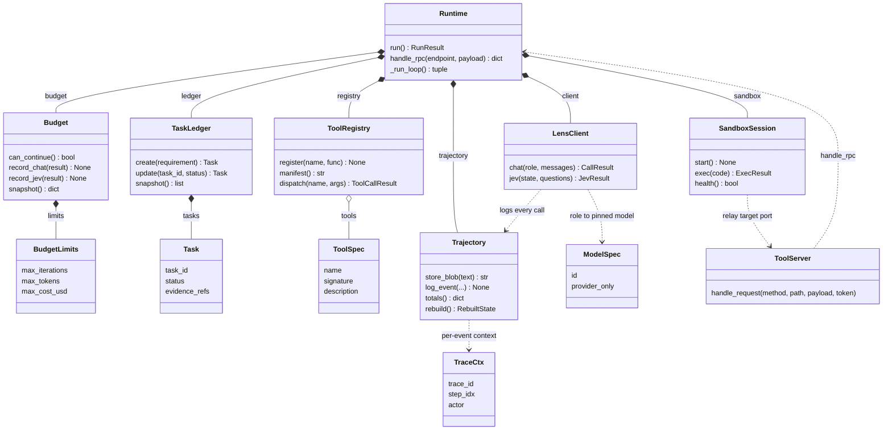
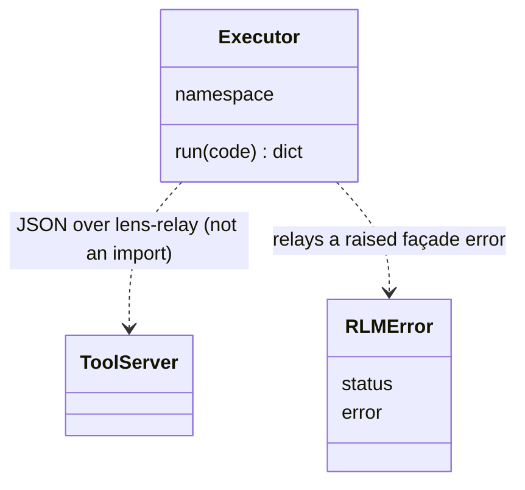
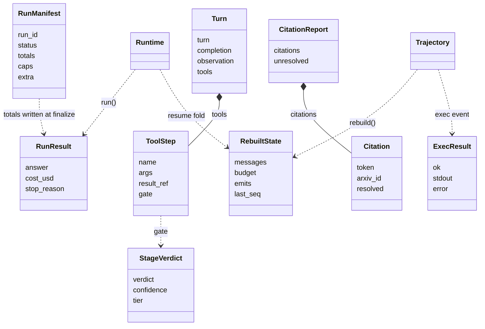
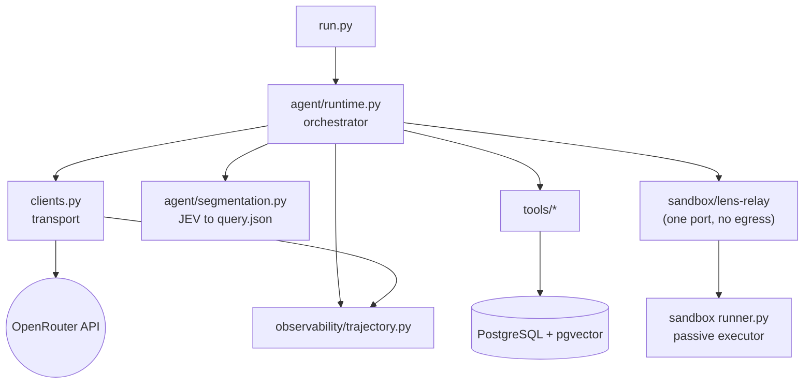
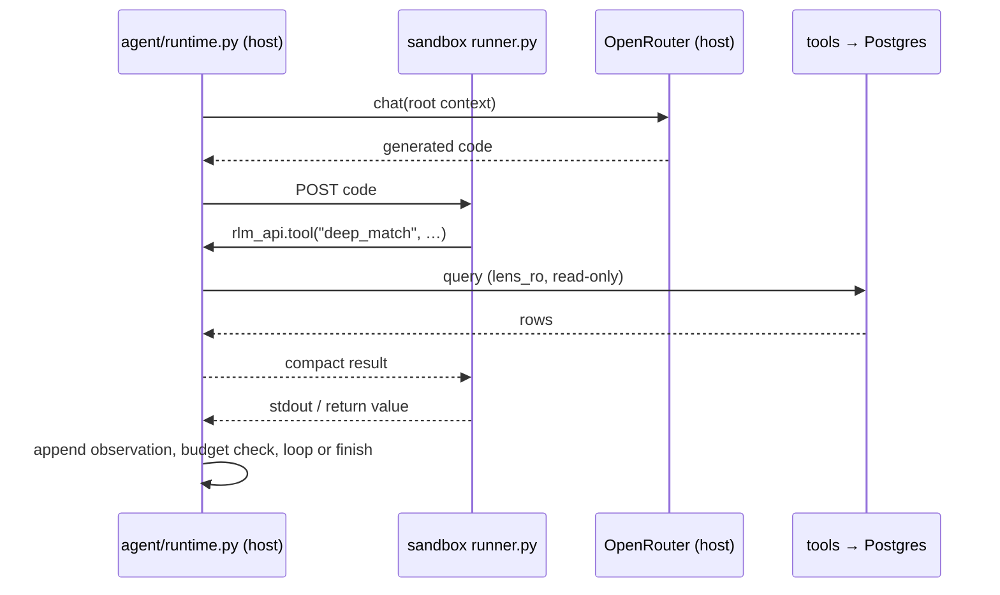

# LENS — Architecture & Module Interactions

> **Purpose:** how the harness modules and classes interact: the layer boundaries,
> the one-way dependencies, and the contracts that keep a run auditable.
>
> **Status:** covers the built and live system; the loop has run end to end against
> the real corpus. Section 2 holds the module graph (generated from the package),
> section 3 the hand-curated class map, and section 5 records why the raw class
> links are sparse.

---

## 1. Layered overview

Two runtimes, **one-way imports**:

- **Host** (Windows-native Python 3.12) owns the loop, the API key, the DB
  credentials, and the logs.
- **Sandbox** executes the RLM's generated Python only. It holds
  **no key and no DB driver**; every external effect is an RPC back to the host.

| Module | Responsibility | Imports |
|---|---|---|
| `src/lens/models.py` | Shared types: `Role`, `CallResult`, `JevResult`, `Question`. No project imports (bottom of the graph). | stdlib + `pydantic` |
| `src/lens/config.py` | Paths, endpoints, guardrails, DB settings, `MODEL_REGISTRY`, `JEV_MODEL_ID`, `require_api_key()`. | `models` |
| `src/lens/observability/trajectory.py` | Injected sink: `Trajectory` (content-addressed blobs + one-schema JSONL) and `TraceCtx`. | `config` |
| `src/lens/clients.py` | Transport: `LensClient.chat()` / `.jev()` — auth, retries, provider pinning, `usage`/cost. Stateless. | `config`, `models`, `trajectory` |
| `src/lens/dataset/manifest.py` | : single-pass cs.AI filter → `manifest.json` + JSONL checkpoint. | `config` |
| `src/lens/db/connect.py` | : `connect(readonly=…)` → psycopg connection (admin / `lens_ro`). | `config` |
| `src/lens/db/schema.py` | : idempotent pgvector migration + `tables_exist()`. | `config` |
| `src/lens/tools/*` ** | Host tools: `shallow_match`, `rerank_papers`, `deep_match`, `rerank_chunks`, `build_kg`, `evaluate_stage`. | `config`, DB driver |
| `src/lens/agent/runtime.py` ** | Orchestrator: owns the loop, context compaction, sub-calls, budget, ledger, RPC dispatch. | `clients`, `tools`, `trajectory`, `experiments.arm` |
| `src/lens/agent/{context,budget,ledger,tool_registry,tool_server,sandbox_session}.py` ** | Context assembly, caps, `tasks.json`, tool manifest/dispatch, host RPC, Docker lifecycle. | `config`, `clients`, `trajectory` |
| `src/lens/sandbox/{runner,rlm_api,relay,exec_client}.py` ** | Passive executor, façade (`tool()` / `sub_call()` / `budget()` / `emit()` / `note()`), the single-destination relay, the in-container exec client. | sandbox only (no project imports) |
| `src/lens/tools/{evaluate,sql}.py` ** | Per-stage gate + final groundedness gate; gated T3 `query(sql)`. | `clients`, DB driver |
| `src/lens/agent/runstore.py` ** | `manifest.json` (identity/index), `resume.json` (cache), `list_runs`, `sweep_interrupted`, `fork_run`, bundle export/import. | `config` (lazy) |
| `src/lens/observability/{replay,citations}.py` ** | `replay_turns` (one turn per `step_idx`), `resolve_citations` → `sources.md`. | `trajectory`, `context`, `config` |
| `src/lens/experiments/{arm,campaign}.py` ** | Arm fingerprint (recorded in `manifest.json`) + campaign matrix (validated, expanded to subprocess jobs). | `config` |
| `src/lens/run.py` ** | Entry point: `python -m lens.run "<query>"`, `--list/--show/--resume/--fork/--export/--import`; the only module that builds the object graph. | `agent.runtime`, `agent.runstore`, `tools`, `embeddings`, `reranking`, `kg_extract`, `connect` |

**Import direction (no cycles):** `models` ← `config` ← {`trajectory`, `clients`,
`manifest`, `connect`, `schema`} ← `agent.{budget,ledger,context,tool_registry,tool_server,sandbox_session}`
← `agent.runtime` ← `run`. The sandbox trio (`runner`, `rlm_api`, `relay`) and
`kg_query` are the exception by design: they import **nothing** from `lens`.

---

## 2. Module dependency graph (auto-generated)

Source: `docs/packages_lens.mmd` (pyreverse, regenerated 26 Oct 2026). Edges are
file-level imports. This graph **is** complete and correct: all 45 analysed modules,
including `agent/`, `sandbox/`, `tools/`, `experiments/` and `run.py`.

```mermaid
classDiagram
  class lens {
  }
  class agent {
  }
  class budget {
  }
  class context {
  }
  class ledger {
  }
  class runstore {
  }
  class runtime {
  }
  class sandbox_session {
  }
  class segmentation {
  }
  class tool_registry {
  }
  class tool_server {
  }
  class chunking {
  }
  class clients {
  }
  class config {
  }
  class dataset {
  }
  class chunks {
  }
  class manifest {
  }
  class papers {
  }
  class db {
  }
  class connect {
  }
  class schema {
  }
  class embeddings {
  }
  class experiments {
  }
  class arm {
  }
  class campaign {
  }
  class kg_extract {
  }
  class kg_gold {
  }
  class kg_postprocess {
  }
  class kg_query {
  }
  class kg_verify {
  }
  class models {
  }
  class observability {
  }
  class citations {
  }
  class replay {
  }
  class run_logging {
  }
  class trajectory {
  }
  class reranking {
  }
  class run {
  }
  class sandbox {
  }
  class exec_client {
  }
  class relay {
  }
  class rlm_api {
  }
  class runner {
  }
  class tools {
  }
  class evaluate {
  }
  class kg {
  }
  class retrieval {
  }
  class sql {
  }
  agent --> segmentation
  budget --> lens
  budget --> config
  budget --> models
  context --> lens
  context --> config
  runstore --> lens
  runstore --> config
  runtime --> lens
  runtime --> budget
  runtime --> context
  runtime --> ledger
  runtime --> runstore
  runtime --> sandbox_session
  runtime --> segmentation
  runtime --> tool_registry
  runtime --> clients
  runtime --> config
  runtime --> arm
  runtime --> citations
  runtime --> trajectory
  runtime --> evaluate
  runtime --> retrieval
  sandbox_session --> lens
  sandbox_session --> config
  segmentation --> clients
  segmentation --> trajectory
  tool_registry --> lens
  tool_registry --> config
  tool_registry --> trajectory
  tool_server --> lens
  tool_server --> config
  clients --> lens
  clients --> config
  clients --> models
  clients --> trajectory
  config --> models
  dataset --> manifest
  dataset --> papers
  chunks --> lens
  chunks --> chunking
  chunks --> config
  chunks --> embeddings
  manifest --> lens
  manifest --> config
  papers --> lens
  papers --> config
  papers --> embeddings
  db --> connect
  db --> schema
  connect --> lens
  connect --> config
  schema --> lens
  schema --> config
  embeddings --> lens
  embeddings --> config
  arm --> lens
  arm --> config
  kg_extract --> lens
  kg_extract --> config
  kg_gold --> kg_postprocess
  kg_gold --> kg
  kg_postprocess --> lens
  kg_postprocess --> config
  kg_postprocess --> kg_extract
  kg_verify --> lens
  kg_verify --> config
  kg_verify --> models
  observability --> trajectory
  citations --> lens
  citations --> config
  citations --> replay
  citations --> trajectory
  replay --> lens
  replay --> context
  replay --> config
  replay --> trajectory
  run_logging --> lens
  run_logging --> config
  trajectory --> config
  reranking --> lens
  reranking --> config
  run --> lens
  run --> agent
  run --> runstore
  run --> runtime
  run --> sandbox_session
  run --> tool_registry
  run --> tool_server
  run --> clients
  run --> config
  run --> connect
  run --> embeddings
  run --> kg_extract
  run --> trajectory
  run --> reranking
  run --> kg
  run --> retrieval
  run --> sql
  runner --> rlm_api
  tools --> retrieval
  evaluate --> lens
  evaluate --> clients
  evaluate --> config
  evaluate --> models
  evaluate --> trajectory
  kg --> lens
  kg --> config
  kg --> kg_extract
  kg --> kg_postprocess
  kg --> kg_query
  kg --> kg_verify
  kg --> retrieval
  retrieval --> lens
  retrieval --> config
  retrieval --> embeddings
  retrieval --> reranking
  sql --> lens
  sql --> config
```



> Read it for the **invariant**, not the detail: edges point *down* the layers
> (`run → agent → tools → config → models`) and never back up. The `lens` nodes are
> package `__init__` re-exports (`db → connect`, `dataset → manifest`);
> `observability → trajectory` is the same pattern.
>
> Two edges deserve a note: `runtime → arm` is the arm fingerprint
> (`experiments/arm.py`), and `run → {connect, embeddings, kg_extract, reranking,
> sql}` is the CLI's dependency wiring — `run.py` is the only module allowed to touch
> every layer, because that is where the object graph is built.

---

## 3. Class map

> **Hand-authored, and here is why.** `pyreverse` cannot see how this harness is
> wired. It links an attribute only when it can *infer a value* — a constructed
> default (`Budget()`, `BudgetLimits()`, `Task()`) or an attribute-level annotation.
> LENS injects its collaborators through **keyword-only** parameters
> (`*, client: LensClient` … then `self.client = client`), which pyreverse ignores.
> Measured on the real package: **6 relationships across 43 classes**, one of them a
> false positive (`JevResult --o DirectionVerifier`, inferred from a default-arg
> construction, not ownership). The raw output is kept for reference in; the
> diagrams below are the ones to read.

### 3.1 Harness core — who owns whom



**Reading it.** `Runtime` is the only class that composes the others; everything it
needs arrives through the constructor, which is what makes `tests/test_runtime.py`
runnable with fakes and **no** Docker, DB or key. The two dashed edges are the ones
a reader usually gets wrong:

- `ToolServer ..> Runtime` — the host RPC server holds a runtime and calls
  `handle_rpc`; the runtime never imports the server.
- `SandboxSession ..> ToolServer` — a *port number*, not an import: the session
  forwards the port the server bound to `lens-relay`, which is the sandbox's only
  route to the host.

### 3.2 Sandbox pair (a separate process, no project imports)



The executor is **passive**: it runs a block in one persistent namespace and never
calls a model or the DB. `rlm_api` (the façade the generated code imports) raises
`RLMError`; the executor relays that as a structured envelope, so a failed *block*
is a 200 with `ok: false` while a failed *transport* is not.

### 3.3 Artifact types (the dataclasses that cross module boundaries)



Each of these is a **serialisation boundary**: `RunManifest` is `manifest.json`,
`Turn`/`ToolStep` are the M10b timeline, `CitationReport` is `sources.md`,
`ExecResult` is the `/exec` envelope. `Runtime` and `Trajectory` appear here as
endpoints only — their ownership is.

### 3.4 Raw pyreverse output (reference only)

`docs/classes_lens.mmd` — 43 classes, regenerated 26 Oct 2026. The complete
relationship set it could infer:

```
Runtime --> Budget : budget
Budget --> BudgetLimits : limits
TaskLedger --> Task : tasks
Runtime --> TaskLedger : ledger
JevResult --o DirectionVerifier : jev_call     <- false positive
Trajectory --o LensClient : trajectory         <- direction reads backwards
```

Do not paste the whole file into this section: it duplicates the artifact and the two
drift apart. Read it from
`docs/classes_lens.mmd` when you need attribute-level detail.

---

## 4. Runtime interactions (not visible in import graphs)

The important flows are **runtime**, not imports — this is the part a static tool
cannot produce.

### 4.1 Request path (live)



### 4.2 Host ↔ sandbox loop

The host pulls every turn; the sandbox is a **passive** executor. The DB and the
LLM are reached **only** from the host — the sandbox never holds the key or a DB
driver.



> `db/connect.py` is used **only** by the host side of this loop (the tool layer),
> never imported by the sandbox.

### 4.3 harness scaffold (18 Oct 2026, logic filled by 25 Oct 2026)

The harness is **built and live**: all fifteen modules are filled and reviewed
, and the loop has executed end-to-end against the real corpus —
the note "no live sandbox query has run yet" is superseded by. Suite:
**463 tests — 462 pass, 1 skip, 0 pending** (no key, zero cost); `ruff check` clean.

Invariants fixed in the rework: the sandbox mounts **`<run_dir>/work`** only (run
artifacts live one level up and cannot be rewritten by generated code); caps are
**derived and ordered** (8 iterations · 40k context · 300k tokens derived from
them · **$1.00** per query, raised from $0.50 on 26 Oct 2026 after the anchor spent
87 % of it — · 80 % wrap-up nudge · root output 8k); a reported `$/query`
comes from `Trajectory.totals()`, not `Budget`; `emit()` returns a container path;
the KG traversal helpers ship in the image as `kg_query`.

#### 4.3.1 — first live runs (25 Oct 2026)

| Step | Result | LOG |
|---|---|---|
| sandbox boundary | `verify_sandbox.py` **8/8** (host RPC 200, egress blocked, timeout, artifacts hidden, no secrets) | 114 |
| plumbing (mini) | 8 iterations, 43–52 tool calls, ledger written, 46/46 citations resolved | 115 |
| crash-resume | killed mid-loop → `--list` sweeps to `interrupted` → `--resume` finishes; history a byte-identical prefix | 116 |
| portable bundle | export 1.13 MB / 138 blobs → import → replay **identical**, 0 `missing_refs`; a one-byte flip is rejected | 116 |
| gpt-5 E2E | 13/13 citations, `$0.436`, gate rejects unprovable global negatives (correctly) | 117 |
| five-query smoke | 5/5 pass `check_run`, 47/47 citations, `$0.2568` | 118 |
| artifacts | `answer.md` + `sources.md` + `report.md` per run | 119 |

**The RPC path changed at.** `host.docker.internal` is **unreachable** from an
`internal: true` bridge on Docker Desktop/Windows (measured: `host-gateway` → the
WSL2 VM → `ENETUNREACH`; no DNS without it; the host's real address is off-bridge).
The sandbox therefore dials **`lens-relay`**, a container on `sandbox-net` +
`rpc-net` that forwards one hard-coded `host:port`. No port is published (an internal
network drops the mapping). Egress stays blocked and is still probed after the relay
exists. Contract:.

| Component | Responsibility | Promise |
|---|---|---|
| `agent/runtime.py` | Owns the loop, RPC handlers, final/partial answer. | Host-pulled; every turn logged; stops at caps. |
| `agent/context.py` | System prompt, tool manifest, `query.json`, budget, memory, compaction. | Root context stays bounded; large data stays in the sandbox. |
| `agent/budget.py` | Iterations, tokens, cost, exec seconds, backtracks. | `budget()` is read-only; the orchestrator alone enforces caps. |
| `agent/ledger.py` | Atomic `tasks.json`. | backtracking source; crash-recoverable. |
| `agent/tool_registry.py` | Manifest + dispatch. | Names/signatures/docstrings only; args hashed; full result blobbed. |
| `agent/tool_server.py` | Host RPC endpoints. | Sandbox reaches only `/tool`, `/sub_call`, `/budget`, `/emit`, `/note`; per-run token. |
| `agent/sandbox_session.py` | Compose lifecycle + `/exec` client. | One container per run (plus the relay); mounts `<run_dir>/work` only; `host_rpc_port` forwarded to the relay as `LENS_RELAY_TARGET_PORT`; cleanup on failure. |
| `sandbox/runner.py` | Passive persistent executor. | Variables survive steps; never calls an LLM; 120 s timeout. |
| `sandbox/rlm_api.py` | Façade. | No key/DB; depth-1 only; no recursion. |
| `kg_query.py` | Pure KG traversal (`kg_neighbors` / `kg_triples` / `kg_subgraph`). | Copied into the image as `kg_query`; `tools/kg.py` re-exports it (one source of truth). |
| `tools/evaluate.py` | Three-tier stage gate. | Verdict + failing criterion; logged. |
| `tools/sql.py` | Gated T3. | Read-only; off by default; forced off in recorded runs. |
| `agent/runstore.py` ** | `manifest.json` (identity/index), `resume.json` (cache), `list_runs`, `sweep_interrupted`, `fork_run`. | Tolerant readers (unknown keys preserved); atomic writes; manifest + cache live in `run_dir`, never `work/`. |
| `run.py` | CLI wiring. | `python -m lens.run "<query>"`; `--list` / `--show` / `--resume` / `--fork` / `--no-replay`. |

**Protocol pinned by the scaffold**

- Final answer = explicit **`FINAL_ANSWER:`** sentinel, recognised only **outside** a
  fenced block (a sentinel printed from Python is code, not an answer).
- Host and runner use Python **stdlib HTTP**; the sandbox calls the host through
  **`lens-relay`**, never `host.docker.internal`.
- `docker-compose.yaml` declares `lens-pg`, `lens-repl` **and** `lens-relay`; the DB
  is on its own network, `sandbox-net` is `internal: true`, and only the relay sits
  on `rpc-net` (its trusted side).
- The sandbox holds **no OpenRouter key and no DB driver**.
- Fill order (historical, all done): budget → ledger → context → registry → tool
  server → `rlm_api` → `runner` → `sandbox_session` → `runtime` → `run.py` →
  evaluate/sql → **runstore**.

**One-time migration:** stop/remove the old manual `lens-pg` container before
compose starts; the `lens-pgdata` volume preserves data. Verify the host boundary in
order — host RPC reachable from the container **through the relay** → general egress
**blocked** → `/exec` reachable from the host via `docker compose exec`. Do **not**
drop `internal`; the no-egress property is a claim, and the
fixed-subnet fallback from the notes **does not work** on Docker Desktop.

---

### 4.4 session persistence (19 Oct 2026)

**The log is the session.** Every turn appends a root `chat` event (whose
`prompt_ref` is the exact request body), an `exec` event (`code_ref` +
`stdout_ref`) and a `budget` snapshot, so the root message list, the counters and
the namespace map are **folded** from `trajectory.jsonl`
(`Trajectory.rebuild() -> RebuiltState`) rather than duplicated into a checkpoint.
That is the whole design: a session cannot drift from its own record.

| File | Role | Authoritative? |
|---|---|---|
| `manifest.json` | identity + status + index (id, query, parent, models, caps, totals, provenance, artifacts) | yes (which runs exist / what state) |
| `trajectory.jsonl` | the event log | yes (state) |
| `resume.json` | cache: emit map (`var -> ref`) + workspace hashes + `namespace_complete` | no — rebuildable |
| `tasks.json` / `work/` / `answer.md` | ledger / sandbox workspace / answer | yes |

Resume = **rebuild**, never restore a container: new sandbox → context files
rewritten into `work/` → `query.json` read from disk (re-segmenting would spend a
call and could silently change the retrieval) → variables restored from **emit
blobs only** → one `run.resume` note appended → continue at `last_seq`. A variable
that was never emitted sets `namespace_complete: false` and the root is told to
re-derive it — a labelled degraded resume.

Recorded replay serves a tool result from `(tool, args_hash) -> result_ref` when
present, tagged `"replayed": true`, so a replay is deterministic **and** offline.
A fork is provenance (new run, `parent_run_id`, **fresh** log); resume is
continuation. `--list` / `--show` build no runtime — they are what the UI
calls.

Design rationale + the six-harness comparison:.
Tests: `tests/test_runstore.py`, plus `rebuild` in `test_trajectory.py` and
resume/replay in `test_runtime.py` / `test_run_wiring.py`.

### 4.5 Demo playback + portable bundle

A full run needs a GPU (embeddings, reranker, GLiNER), the DB, Docker and a key,
so a live demo is not reproducible on an
be interrogated. The recording can: `observability/replay.py` folds the log into
**one `Turn` per `step_idx`** (completion, code, `stdout_full`, the **observation
the model saw**, `tools[]` with args/latency/gate, `emits`, `budget`,
`missing_refs`), and `replay_summary()` supplies the header numbers.

| Mode | What it is | Needs |
|---|---|---|
| **A. scrubbed playback** (the demo) | viewer over a recording; `Step`/`Play` move a cursor | Python + Streamlit |
| **B. deterministic harness replay** | re-runs the loop serving recorded tool results | Docker (no key/GPU) |
| **C. live run** | the pipeline | GPU, DB, key |

Blobs live in **one global deduplicated store** (`<runs_root>/blobs/`), so copying
a run directory alone leaves every ref dangling. `--export` writes
`<run_id>.lens/` with the artifacts, `work/` (minus `emits/`) and **only the
referenced blobs** plus `bundle.json` (sizes, `trajectory_sha256`, missing refs);
`--import` re-hashes every blob and refuses on mismatch. `args_ref` on tool events
is what makes a call renderable (`args_hash` alone cannot be shown).

Tests: `tests/test_replay.py`; bundle contracts in `test_runstore.py`.

---

## 5. Regenerating the diagrams

The `.mmd` files are generated by **pyreverse** (ships with `pylint`); no Graphviz is
required for Mermaid output. Run from the repo root:

```powershell
uv run --with pylint --no-project pyreverse -o mmd -d docs -p lens src/lens
```

This rewrites `docs/packages_lens.mmd` and `docs/classes_lens.mmd`. Then:

| File | What to do |
|---|---|
| `packages_lens.mmd` | paste into — it is complete and correct (45 modules) |
| `classes_lens.mmd` | **leave as reference**; do not paste it into –, which are hand-authored |

> **Why the class diagram comes out unlinked — do not re-debug this.** pyreverse
> links an attribute only when it can infer a *value*: a constructed default
> (`Budget()`) or an attribute-level annotation. LENS injects collaborators through
> **keyword-only** parameters (`*, client: LensClient` → `self.client = client`),
> which pyreverse ignores — verified by probing the same two-class pattern with and
> without `*,` (26 Oct 2026). Result: 6 relationships across 43 classes, one a false
> positive. `Any`-typed dependencies (`conn`, `embedder`, `reranker`, `extractor`)
> can never link at all. If you want the auto file to show more, annotate the
> **attribute** (`self.client: LensClient = client`) — that is what pyreverse reads.

Optional crisp SVG/PNG: install Graphviz, then
`uv run --with pylint --no-project pyreverse -o png -d docs -p lens src/lens`.
That renders the same sparse graph — it fixes resolution, not inference.

---

## 6. Notes and caveats

- The generated package graph is **complete**: it includes `agent/`, `sandbox/`,
  `tools/`, `experiments/` and `run.py`. The class map is curated by hand
  for the reason in; keeps the raw output.
- Static graphs show **imports and classes**, not the host↔sandbox RPC, the DB access
  path, or the per-run data flow; covers those.
- One-way import direction is the invariant to keep; a future
  [`import-linter`](https://import-linter.readthedocs.io/) contract could enforce it
  in tests (not added yet).
- This file is **not** generated. is a paste of a generated artifact, so it can go
  stale — that is what happened between 18 Oct and 26 Oct. When a milestone lands,
  run the command above and paste; the blocks change only when the ownership
  graph changes.
