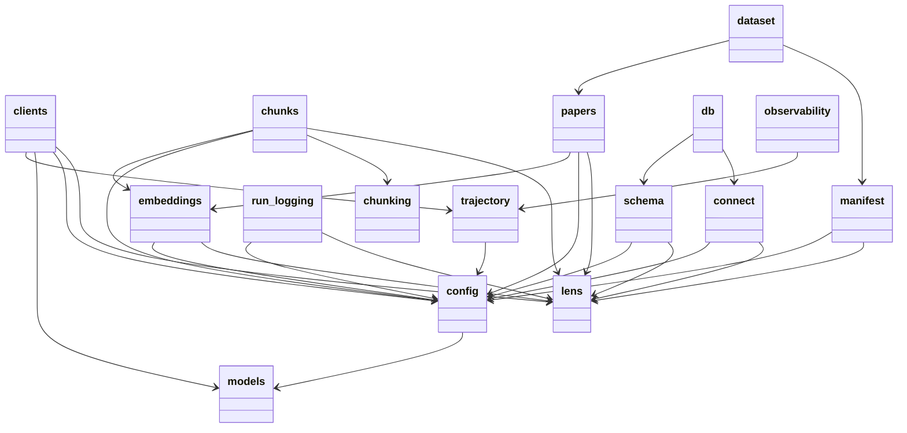
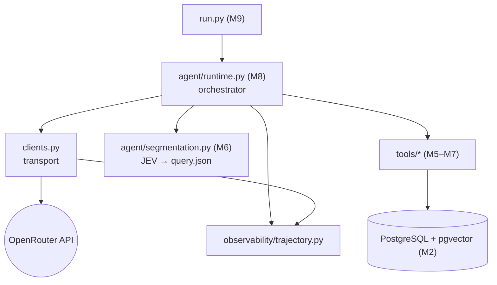
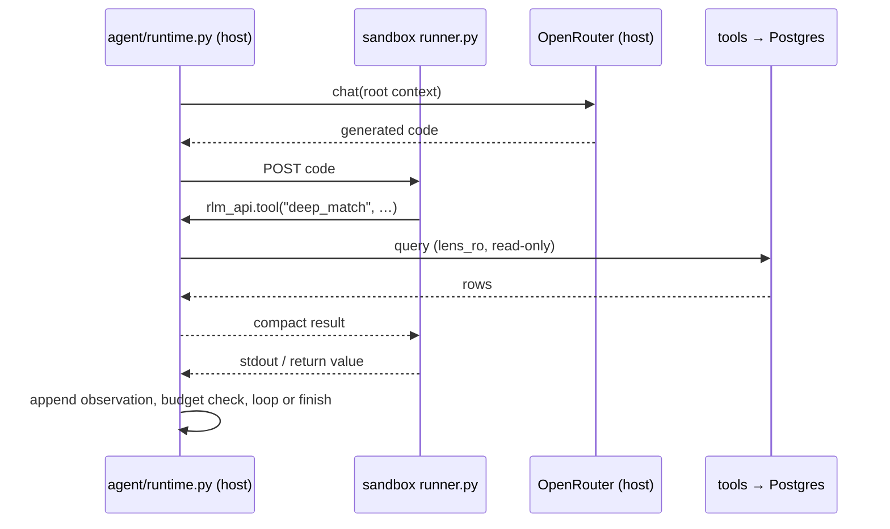

# LENS — Architecture & Module Interactions

> **Purpose:** document how the LENS harness modules and classes interact, for the
> weekly advisor review. Companion to `Thesis Drafts/Tech Stack (Draft).md` §4a/§4d
> (harness architecture + module map), which is thesis-side; this file is the
> **repo-side** engineering view.
>
> **Status:** covers the built layers **M0–M7** plus the **M8 harness scaffold**
> (18 Oct 2026). M8 logic bodies are student-owned (scaffold-and-fill, LOG-33).
> Regenerate the structural diagrams after M8 logic lands (see §5).
>
> **Owner:** LENS thesis student. **Assistant-authored draft.**

---

## 1. Layered overview

Two runtimes, **one-way imports**:

- **Host** (Windows-native Python 3.12) owns the loop, the API key, the DB
  credentials, and the logs.
- **Sandbox** (`lens-repl`, M8) executes the RLM's generated Python only. It holds
  **no key and no DB driver**; every external effect is an RPC back to the host.

| Module | Responsibility | Imports |
|---|---|---|
| `src/lens/models.py` | Shared types: `Role`, `CallResult`, `JevResult`, `Question`. No project imports (bottom of the graph). | stdlib + `pydantic` |
| `src/lens/config.py` | Paths, endpoints, guardrails, DB settings, `MODEL_REGISTRY`, `JEV_MODEL_ID`, `require_api_key()`. | `models` |
| `src/lens/observability/trajectory.py` | Injected sink: `Trajectory` (content-addressed blobs + one-schema JSONL) and `TraceCtx`. | `config` |
| `src/lens/clients.py` | Transport: `LensClient.chat()` / `.jev()` — auth, retries, provider pinning, `usage`/cost. Stateless. | `config`, `models`, `trajectory` |
| `src/lens/dataset/manifest.py` | M1: single-pass cs.AI filter → `manifest.json` + JSONL checkpoint. | `config` |
| `src/lens/db/connect.py` | M2: `connect(readonly=…)` → psycopg connection (admin / `lens_ro`). | `config` |
| `src/lens/db/schema.py` | M2: idempotent pgvector migration + `tables_exist()`. | `config` |
| `src/lens/tools/*` *(M5–M7)* | Host tools: `shallow_match`, `rerank_papers`, `deep_match`, `rerank_chunks`, `build_kg`, `evaluate_stage`. | `config`, DB driver |
| `src/lens/agent/runtime.py` *(M8 scaffold)* | Orchestrator: owns the loop, context compaction, sub-calls, budget, ledger. | `clients`, `tools`, `trajectory` |
| `src/lens/agent/{context,budget,ledger,tool_registry,tool_server,sandbox_session}.py` *(M8 scaffold)* | Context assembly, caps, `tasks.json`, tool manifest/dispatch, host RPC, Docker lifecycle. | `config`, `clients`, `trajectory` |
| `src/lens/sandbox/{runner,rlm_api}.py` *(M8 scaffold)* | Passive executor + façade (`tool()` / `sub_call()` / `budget()` / `emit()` / `note()`). | sandbox only |
| `src/lens/tools/{evaluate,sql}.py` *(M8 scaffold)* | Per-stage gate; gated T3 `query(sql)`. | `clients`, DB driver |
| `src/lens/agent/runstore.py` *(M8.5 scaffold)* | `manifest.json` (identity/index), `resume.json` (cache), `list_runs`, `sweep_interrupted`, `fork_run`. | `config` (lazy) |
| `src/lens/run.py` *(M8 scaffold/M9)* | Entry point: `python -m lens.run "<query>"`, `--list/--show/--resume/--fork`. | `agent.runtime`, `agent.runstore` |

**Import direction (no cycles):** `models` ← `config` ← {`trajectory`, `clients`,
`manifest`, `connect`, `schema`} ← `agent.{budget,ledger,context,tool_registry,tool_server,sandbox_session}`
← `agent.runtime` ← `run`.

---

## 2. Module dependency graph (auto-generated)

Source: `docs/packages_lens.mmd` (pyreverse). Edges are file-level imports.



> The `lens` nodes are package `__init__` re-exports (`db → connect`, `db → schema`,
> `dataset → manifest`); `observability → trajectory` is the same pattern.

---

## 3. Class map (auto-generated)

Source: `docs/classes_lens.mmd` (pyreverse). Attributes/methods omitted for width.

```mermaid
classDiagram
    class CallResult {
        cost_usd : float
        finish_reason : str | None
        latency_ms : int
        message : dict[str, Any]
        model : str
        model_snapshot : str | None
        provider : str
        text : str
        tokens_in : int
        tokens_out : int
    }
    class Chunk {
        chunk_text : str
        section_order : int
        section_type : str
        token_count : int
    }
    class Embedder {
        dim : int
        model : Any
        model_id : str
        encode_documents(texts: Sequence[str], task_prefix: str, batch_size: int) np.ndarray
    }
    class JevResult {
        answers : dict[str, dict[str, Any]]
        cost_usd : float
        latency_ms : int
        model : str
        provider : str
        tokens_in : int
    }
    class LensClient {
        api_key : NoneType
        base_url : str
        chat_endpoint : str
        jev_endpoint : str
        max_retries : int
        registry : dict
        session : Session
        sleeper
        timeout : int
        trajectory
        chat(role: Role, messages: Sequence[Mapping[str, Any]]) CallResult
        jev(state: str, questions: Mapping[str, Question]) JevResult
    }
    class LensTransportError {
        attempts : int
        status : NoneType
    }
    class ModelSpec {
        allow_fallbacks : bool
        exacto : bool
        id : str
        provider_only : tuple[str, ...]
        provider_order : tuple[str, ...]
        reasoning_effort : str | None
        seed : int | None
        supports_reasoning : bool
        supports_response_format : bool
        supports_tools : bool
        temperature : float | None
    }
    class Question {
        criteria : dict[str, str] | list[str]
        instructions : str
        type : Literal
    }
    class Section {
        paragraphs : tuple[str, ...]
        section_type : str
    }
    class StreamLogger {
        flush() None
        write(message: str) int
    }
    class TraceCtx {
        actor : Literal
        step_idx : int
        trace_id : str
    }
    class Trajectory {
        blobs_dir
        run_dir
        run_id : str
        runs_root : Path
        trajectory_path
        log_event() None
        store_blob(text: str) str
    }
  Trajectory --o LensClient : trajectory
```



**Key interactions (built):**
- `LensClient.__init__` takes a `Trajectory` (the `--o` composition): every
  `chat()`/`jev()` call stores blobs and logs exactly one event.
- `LensClient` resolves its model through `config.MODEL_REGISTRY` (`ModelSpec`),
  validated JEV inputs via `Question`, and returns `CallResult` / `JevResult`.
- `db.connect()` returns a raw `psycopg.Connection`; `db.schema` operates on it.

---

## 4. Runtime interactions (not visible in import graphs)

The important flows are **runtime**, not imports — this is the part a static tool
cannot produce.

### 4.1 Request path (M8 target)



### 4.2 Host ↔ sandbox loop (M8, `Tech Stack §4a`)

The host pulls every turn; the sandbox is a **passive** executor. The DB and the
LLM are reached **only** from the host — the sandbox never holds the key or a DB
driver.



> `db/connect.py` is used **only** by the host side of this loop (the tool layer),
> never imported by the sandbox.

### 4.3 M8 harness scaffold (18 Oct 2026)

The harness is **scaffolded and reworked** (LOG-92); all logic bodies are
student-owned. Suite: **325 tests — 235 pass, 90 contract tests**
`NotImplementedError` until filled (`budget` + `ledger` + `trajectory`, LOG-96/97/98).
`compileall` and `docker compose config` pass. No live sandbox query has run yet.

Invariants fixed in the rework: the sandbox mounts **`<run_dir>/work`** only (run
artifacts live one level up and cannot be rewritten by generated code); caps are
**derived and ordered** (8 iterations · 40k context · 300k tokens derived from
them · $0.50 · 80 % wrap-up nudge · root output 8k); a reported `$/query` comes
from `Trajectory.totals()`, not `Budget`; `emit()` returns a container path; the
KG traversal helpers ship in the image as `kg_query`.

| Component | Responsibility | Promise |
|---|---|---|
| `agent/runtime.py` | Owns the loop, RPC handlers, final/partial answer. | Host-pulled; every turn logged; stops at caps. |
| `agent/context.py` | System prompt, tool manifest, `query.json`, budget, memory, compaction. | Root context stays bounded; large data stays in the sandbox. |
| `agent/budget.py` | Iterations, tokens, cost, exec seconds, backtracks. | `budget()` is read-only; the orchestrator alone enforces caps. |
| `agent/ledger.py` | Atomic `tasks.json`. | F-01 backtracking source; crash-recoverable. |
| `agent/tool_registry.py` | Manifest + dispatch. | Names/signatures/docstrings only; args hashed; full result blobbed. |
| `agent/tool_server.py` | Host RPC endpoints. | Sandbox reaches only `/tool`, `/sub_call`, `/budget`, `/emit`, `/note`; per-run token. |
| `agent/sandbox_session.py` | Compose lifecycle + `/exec` client. | One container per run; mounts `<run_dir>/work` only; `host_rpc_url` from the real bound port; cleanup on failure. |
| `sandbox/runner.py` | Passive persistent executor. | Variables survive steps; never calls an LLM; 120 s timeout. |
| `sandbox/rlm_api.py` | Façade. | No key/DB; depth-1 only; no recursion. |
| `kg_query.py` | Pure KG traversal (`kg_neighbors` / `kg_triples` / `kg_subgraph`). | Copied into the image as `kg_query`; `tools/kg.py` re-exports it (one source of truth). |
| `tools/evaluate.py` | Three-tier stage gate. | Verdict + failing criterion; logged. |
| `tools/sql.py` | Gated T3. | Read-only; off by default; forced off in recorded runs. |
| `agent/runstore.py` *(M8.5)* | `manifest.json` (identity/index), `resume.json` (cache), `list_runs`, `sweep_interrupted`, `fork_run`. | Tolerant readers (unknown keys preserved); atomic writes; manifest + cache live in `run_dir`, never `work/`. |
| `run.py` | CLI wiring. | `python -m lens.run "<query>"`; `--list` / `--show` / `--resume` / `--fork` / `--no-replay`. |

**Protocol pinned by the scaffold**

- Final answer = explicit **`FINAL_ANSWER:`** sentinel.
- Host and runner use Python **stdlib HTTP**; the sandbox calls back via
  `host.docker.internal`.
- `docker-compose.yaml` declares **both** `lens-pg` and `lens-repl`; DB and
  sandbox are on separate networks (`sandbox-net` is `internal: true`).
- The sandbox holds **no OpenRouter key and no DB driver**.
- Fill order: budget → ledger → context → registry → tool server → `rlm_api` →
  `runner` → `sandbox_session` → `runtime` → `run.py` → evaluate/sql →
  **runstore** (`M8.5`).

**One-time migration:** stop/remove the old manual `lens-pg` container before
compose starts; the `lens-pgdata` volume preserves data. Verify the three
host-boundary checks together (host RPC reachable from the container → general
egress blocked → `/exec` reachable from the host). If `host.docker.internal`
fails on `internal: true`, use the fixed-subnet + bridge-gateway URL — do **not**
drop `internal`, the no-egress property is a claim (`Tech Stack` §4b).

---

### 4.4 M8.5 session persistence (19 Oct 2026)

**The log is the session.** Every turn appends a root `chat` event (whose
`prompt_ref` is the exact request body), an `exec` event (`code_ref` +
`stdout_ref`) and a `budget` snapshot, so the root message list, the counters and
the namespace map are **folded** from `trajectory.jsonl`
(`Trajectory.rebuild() -> RebuiltState`) rather than duplicated into a checkpoint.
That is the whole design: a session cannot drift from its own record.

| File | Role | Authoritative? |
|---|---|---|
| `manifest.json` | identity + status + index (id, query, parent, models, caps, totals, provenance, artifacts) | yes (which runs exist / what state) |
| `trajectory.jsonl` | the event log | yes (state) |
| `resume.json` | cache: emit map (`var -> ref`) + workspace hashes + `namespace_complete` | no — rebuildable |
| `tasks.json` / `work/` / `answer.md` | ledger / sandbox workspace / answer | yes |

Resume = **rebuild**, never restore a container: new sandbox → context files
rewritten into `work/` → `query.json` read from disk (re-segmenting would spend a
call and could silently change the retrieval) → variables restored from **emit
blobs only** → one `run.resume` note appended → continue at `last_seq`. A variable
that was never emitted sets `namespace_complete: false` and the root is told to
re-derive it — a labelled degraded resume.

Recorded replay serves a tool result from `(tool, args_hash) -> result_ref` when
present, tagged `"replayed": true`, so a replay is deterministic **and** offline.
A fork is provenance (new run, `parent_run_id`, **fresh** log); resume is
continuation. `--list` / `--show` build no runtime — they are what the M10 UI
calls.

Design rationale + the six-harness comparison: `Tech Stack (Draft).md` §4n.
Tests: `tests/test_runstore.py`, plus `rebuild` in `test_trajectory.py` and
resume/replay in `test_runtime.py` / `test_run_wiring.py`.

### 4.5 Demo playback + portable bundle (M8.5+, 20 Oct 2026)

A full run needs a GPU (embeddings, reranker, GLiNER), the DB, Docker and a key,
so a live demo is not reproducible on an examiner's laptop — and a video cannot
be interrogated. The recording can: `observability/replay.py` folds the log into
**one `Turn` per `step_idx`** (completion, code, `stdout_full`, the **observation
the model saw**, `tools[]` with args/latency/gate, `emits`, `budget`,
`missing_refs`), and `replay_summary()` supplies the header numbers.

| Mode | What it is | Needs |
|---|---|---|
| **A. scrubbed playback** (the demo) | viewer over a recording; `Step`/`Play` move a cursor | Python + Streamlit |
| **B. deterministic harness replay** | re-runs the loop serving recorded tool results | Docker (no key/GPU) |
| **C. live run** | the pipeline | GPU, DB, key |

Blobs live in **one global deduplicated store** (`<runs_root>/blobs/`), so copying
a run directory alone leaves every ref dangling. `--export` writes
`<run_id>.lens/` with the artifacts, `work/` (minus `emits/`) and **only the
referenced blobs** plus `bundle.json` (sizes, `trajectory_sha256`, missing refs);
`--import` re-hashes every blob and refuses on mismatch. `args_ref` on tool events
is what makes a call renderable (`args_hash` alone cannot be shown).

Tests: `tests/test_replay.py`; bundle contracts in `test_runstore.py`.

---

## 5. Regenerating the diagrams

The `.mmd` files are generated by **pyreverse** (ships with `pylint`); no
Graphviz is required for Mermaid output. Run from the repo root:

```powershell
uv run --with pylint --no-project pyreverse -o mmd -d docs -p lens src/lens
```

This rewrites `docs/packages_lens.mmd` and `docs/classes_lens.mmd`. Paste any
changes into §2/§3 above (or regenerate on the next milestone).

Optional crisp SVG/PNG: install Graphviz, then
`uv run --with pylint --no-project pyreverse -o png -d docs -p lens src/lens`.

---

## 6. Notes and caveats

- The generated graphs still omit the M8 scaffold modules; `tools/`, most of
  `agent/`, `sandbox/`, and `run.py` are shown in §4.3 instead. Regenerate after
  M8 logic lands.
- Static graphs show **imports and classes**, not the host↔sandbox RPC or the DB
  access path; §4 covers those.
- One-way import direction is the invariant to keep; a future
  [`import-linter`](https://import-linter.readthedocs.io/) contract could enforce
  it in tests (not added yet).
